# Azure Data Engineer Applications & Technical Collateral

# Dedeepya Majety
### Azure Data Engineer | Databricks Platform Specialist | PySpark & Cloud Lakehouse

 

> **Production Repository:** Contains verified application packets, 1-page ATS resumes, tailored cover letters, 8-slide executive pitch decks, and technical architecture guides for enterprise Cloud Data Engineering roles.

---

## 🏛️ Architecture & Platform Expertise

```mermaid
flowchart LR
    subgraph Bronze [Bronze Tier: Raw Ingestion]
        direction TB
        B1[ADLS Gen2 Source Drop] --> B2[Databricks Auto Loader]
        B2 --> B3[(Bronze Delta Table<br/>Append-only Raw Data)]
    end

    subgraph Silver [Silver Tier: Cleaned & Enriched]
        direction TB
        S1[PySpark Deduplication] --> S2[Schema Enforcement & DQ Rules]
        S2 --> S3[(Silver Delta Table<br/>Conformed Datasets)]
    end

    subgraph Gold [Gold Tier: Business Curated]
        direction TB
        G1[Business Aggregations] --> G2[Star Schema Data Marts]
        G2 --> G3[(Gold Delta Table<br/>Serving Layer)]
    end

    B3 -->|Streaming Micro-batch| S1
    S3 -->|Scheduled Merge / Upsert| G1
    G3 -.->|Direct Lake / Import| PBI[Power BI Dashboards & Ad-hoc SQL]

    classDef bronze fill:#FEF3C7,stroke:#D97706,stroke-width:2px,color:#92400E;
    classDef silver fill:#F1F5F9,stroke:#64748B,stroke-width:2px,color:#334155;
    classDef gold fill:#FEF9C3,stroke:#CA8A04,stroke-width:2px,color:#854D0E;
    classDef serving fill:#E0F2FE,stroke:#0284C7,stroke-width:2px,color:#0369A1;

    class Bronze bronze;
    class Silver silver;
    class Gold gold;
    class PBI serving;
```

---

## 🎯 Target Company Application Packets

Each application directory contains the full 10-stage Unrejectable Pipeline dossier, company intelligence brief, ATS 100/100 1-page resume, branded cover letter, and 8-slide technical pitch deck.

| Company & Target Practice | Role & Req ID | 1-Page Resume | Cover Letter | Pitch Deck (PPTX + PDF) | Pipeline Packet |
| :--- | :--- | :--- | :--- | :--- | :--- |
| **EY Global Delivery Services** | Azure Data Engineer `Req: 4477576256` | [Resume (PDF)](applications/ey-gds-azure-data-engineer-2026-10-12-4477576256-packet/dedeepya-EY-Azure-Data-Engineer-4477576256-resume.pdf) | [Cover Letter](applications/ey-gds-azure-data-engineer-2026-10-12-4477576256-packet/dedeepya-EY-Azure-Data-Engineer-4477576256-cover.pdf) | [Deck (PPTX)](applications/ey-gds-azure-data-engineer-2026-10-12-4477576256-packet/dedeepya-EY-Azure-Data-Engineer-4477576256-pitch.pptx) · [Deck (PDF)](applications/ey-gds-azure-data-engineer-2026-10-12-4477576256-packet/dedeepya-EY-Azure-Data-Engineer-4477576256-pitch.pdf) | [View Packet](applications/ey-gds-azure-data-engineer-2026-10-12-4477576256-packet/) |
| **Accenture** | Data Engineer `Req: 4476918574` | [Resume (PDF)](applications/accenture-data-engineer-2026-10-12-4476918574-packet/dedeepya-Accenture-Data-Engineer-4476918574-resume.pdf) | [Cover Letter](applications/accenture-data-engineer-2026-10-12-4476918574-packet/dedeepya-Accenture-Data-Engineer-4476918574-cover.pdf) | [Deck (PPTX)](applications/accenture-data-engineer-2026-10-12-4476918574-packet/dedeepya-Accenture-Data-Engineer-4476918574-pitch.pptx) · [Deck (PDF)](applications/accenture-data-engineer-2026-10-12-4476918574-packet/dedeepya-Accenture-Data-Engineer-4476918574-pitch.pdf) | [View Packet](applications/accenture-data-engineer-2026-10-12-4476918574-packet/) |
| **PwC** | Financial Services Data Engineer `Req: 4467378631` | [Resume (PDF)](applications/pwc-fs-data-engineer-2026-10-12-4467378631-packet/dedeepya-PwC-FS-Data-Engineer-4467378631-resume.pdf) | [Cover Letter](applications/pwc-fs-data-engineer-2026-10-12-4467378631-packet/dedeepya-PwC-FS-Data-Engineer-4467378631-cover.pdf) | [Deck (PPTX)](applications/pwc-fs-data-engineer-2026-10-12-4467378631-packet/dedeepya-PwC-FS-Data-Engineer-4467378631-pitch.pptx) · [Deck (PDF)](applications/pwc-fs-data-engineer-2026-10-12-4467378631-packet/dedeepya-PwC-FS-Data-Engineer-4467378631-pitch.pdf) | [View Packet](applications/pwc-fs-data-engineer-2026-10-12-4467378631-packet/) |
| **Bristol Myers Squibb (BMS)** | Data Engineer 1 `Req: 4472765590` | [Resume (PDF)](master-collateral/Dedeepya_Certified_Data_Engineer_BMS_Resume.pdf) | [Cover Letter](master-collateral/Dedeepya_Certified_Data_Engineer_BMS_Cover_Letter.pdf) | [Deck (PDF)](master-collateral/Dedeepya_Certified_Data_Engineer_BMS_Pitch.pdf) | [View Packet](applications/bms-data-engineer-1-2026-10-03-4472765590-packet/) |
| **Zoetis** | Data Engineer `Req: 4472331481` | [Resume (PDF)](master-collateral/Dedeepya_Certified_Data_Engineer_Zoetis_Resume.pdf) | [Cover Letter](master-collateral/Dedeepya_Certified_Data_Engineer_Zoetis_Cover_Letter.pdf) | [Deck (PDF)](master-collateral/Dedeepya_Certified_Data_Engineer_Zoetis_Pitch.pdf) | [View Packet](applications/zoetis-data-engineer-2026-10-03-4472331481-packet/) |

---

## 📚 Master Collateral & Architecture Guides

- 📘 [Lakehouse & Data Engineering Mega Guide (PDF)](master-collateral/DEDEEPYA_LAKEHOUSE_AND_DATA_ENGINEERING_MEGA_GUIDE.pdf) · [Markdown](master-collateral/DEDEEPYA_LAKEHOUSE_AND_DATA_ENGINEERING_MEGA_GUIDE.md)
  - 14 core modules spanning PySpark optimization, Delta Lake internals (ACID, Time Travel, Z-Order, Liquid Clustering), Auto Loader, Unity Catalog, and CI/CD pipelines.
- 🏛️ [Delta Lake Medallion Architecture HLD (Markdown)](master-collateral/DELTA_LAKE_MEDALLION_ARCHITECTURE_HLD.md)
  - End-to-end technical high-level design document with streaming ingestion, data quality gates, and Power BI Direct Lake serving.
- 💡 [Data Engineering Scenario Bank (Markdown)](master-collateral/DATA_ENGINEERING_SCENARIO_BANK.md)
  - 25+ real-world production incident response scenarios, skew handling, OOM mitigation, and schema drift handling.
- 📊 [Executive Master Pitch Deck (PPTX)](master-collateral/Dedeepya_Certified_Data_Engineer_Executive_Pitch.pptx) · [PDF](master-collateral/Dedeepya_Certified_Data_Engineer_Executive_Pitch.pdf)
  - 8-slide executive keynote presentation detailing candidate background, 3 core technical execution pillars, architecture, and 30-60-90 day impact roadmap.

---

## 🎯 Day-One Technical Interview Preparation Dossiers

Comprehensive, interview-ready viva guides, system design defenses, live coding drills, and rapid-recall flashcards:

| Dossier | Focus & Target | Formats |
| :--- | :--- | :--- |
| **Master Technical & Architectural Dossier** | Complete Viva, PySpark Engine, Delta Internals, Medallion HLD, Spark UI Skew/OOM Troubleshooting, ADF/Airflow, Unity Catalog, Live Coding | [PDF](interview-prep/DEDEEPYA_INTERVIEW_PREP_MASTER_DOSSIER.pdf) · [Markdown](interview-prep/DEDEEPYA_INTERVIEW_PREP_MASTER_DOSSIER.md) |
| **30-Minute Pre-Interview Quick-Recall Sheet** | 60-Sec Opening Hook, Core Production Metrics, 10 Golden 1-Sentence Viva Answers, PySpark Syntax Flashcards, Notice/Comp Negotiation | [PDF](interview-prep/30_MIN_PRE_INTERVIEW_CHEATSHEET.pdf) · [Markdown](interview-prep/30_MIN_PRE_INTERVIEW_CHEATSHEET.md) |
| **EY GDS Interview Dossier** | Metadata Management, Informatica MDM Match/Merge, Unity Catalog Lineage, Legacy-to-Lakehouse Migration | [PDF](interview-prep/EY_GDS_AZURE_DATA_ENGINEER_DOSSIER.pdf) · [Markdown](interview-prep/EY_GDS_AZURE_DATA_ENGINEER_DOSSIER.md) |
| **Accenture Interview Dossier** | Min 3-Yr Databricks Mandate, PySpark at Scale, Skew & Memory Optimization, Cloud First Lakehouse | [PDF](interview-prep/ACCENTURE_DATA_ENGINEER_DOSSIER.pdf) · [Markdown](interview-prep/ACCENTURE_DATA_ENGINEER_DOSSIER.md) |
| **PwC Acceleration Center Dossier** | Financial Services Reconciliation, Zero Data Loss, SCD Type 2 in Delta Lake, Power BI PL-300 Semantic Models | [PDF](interview-prep/PWC_FINANCIAL_SERVICES_DATA_ENGINEER_DOSSIER.pdf) · [Markdown](interview-prep/PWC_FINANCIAL_SERVICES_DATA_ENGINEER_DOSSIER.md) |

---

## 🛠️ Technical Competencies

| Layer | Technologies & Skills |
| :--- | :--- |
| **Big Data & Compute** | Azure Databricks, Apache Spark, PySpark, Spark SQL, Delta Lake, Auto Loader |
| **Data Governance** | Unity Catalog, Table/Row/Column-level RBAC, Data Lineage, Auditing |
| **Orchestration & ETL** | Azure Data Factory (ADF), Apache Airflow, Python DAGs, Informatica PowerCenter |
| **Cloud Storage** | Azure Data Lake Storage Gen2 (ADLS Gen2), Azure Blob Storage |
| **BI & Analytics** | Microsoft Power BI (PL-300 Certified), DAX Optimization, Data Modeling |
| **Data Quality & MDM** | Informatica MDM (Match/Merge, Golden Records), Great Expectations, DQ Checks |
| **Languages & Tools** | Python, PySpark, SQL, Git, GitHub, Azure DevOps |

---

## 📬 Opportunity Status

- **Candidate:** Dedeepya Majety
- **Total Experience:** 3.9 Years (Associate - Data Engineer @ Cognizant)
- **Current Notice Period:** Serving official notice period at Cognizant
- **Availability:** Immediate / Within 30 days
- **Target Locations:** Chennai, Hyderabad, Bangalore, India (Open to Hybrid / Remote)
- **Email:** [majetydedeepya0@gmail.com](mailto:majetydedeepya0@gmail.com)
- **Portfolio:** [dedeepya-majety-portfolio.vercel.app](https://dedeepya-majety-portfolio.vercel.app)
- **LinkedIn:** [linkedin.com/in/dedeepya-majety](https://www.linkedin.com/in/dedeepya-majety/)
