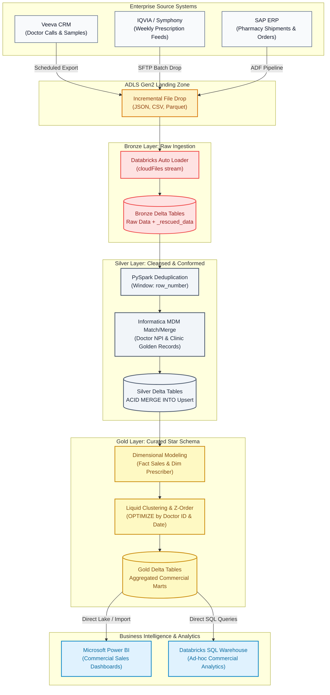

# Dedeepya Majety: Gemini Voice Study Companion & Real-World Amgen Project Deep-Dive
### "From Daily Cognizant Work to Industry Architecture: How to Speak with 100% Confidence in Your Own Words"

> **Instructions for Gemini (When Dedeepya talks to you in Voice Mode):**  
> You are Dedeepya's personal, supportive, and empowering senior technical mentor.  
> 1. Speak in warm, conversational, encouraging English. Never sound like an intimidating textbook or an aggressive interviewer.  
> 2. Dedeepya has 3.9 years of real, solid, production experience at Cognizant working on enterprise data pipelines for a global pharmaceutical client (**Amgen**). She knows how things work, but she is getting used to the formal architecture jargon used by hiring managers.  
> 3. Whenever Dedeepya explains something in her own simple words, **validate her first**: *"Exactly, Dedeepya! What you just said is 100% accurate. Now, to make the interviewer nod in approval, here are the 2 or 3 standard keywords you can drop into that exact sentence..."*  
> 4. Keep your voice answers concise (2 to 4 sentences at a time) so you have an active, two-way conversational flow with her.

---

## 1. The Big Picture: What Your Cognizant Project for Amgen Was Really Doing

Dedeepya, whenever an interviewer asks *"Tell me about your project,"* do not think of it as isolated notebooks or SQL queries. You were building the **Commercial Data Lakehouse Platform for Amgen**, one of the largest biotechnology and pharmaceutical leaders in the world!

### 1.1 The Real-World Business Problem at Amgen
- **Where the data came from:**
  - **Veeva CRM:** Thousands of Amgen sales representatives visiting doctors (HCPs: Healthcare Professionals) and hospitals (HCOs: Healthcare Organizations) logging sales calls, product samples, and meeting notes.
  - **IQVIA / Symphony Health Feeds:** Massive third-party weekly datasets containing millions of anonymized patient prescription records (e.g., for drugs like Enbrel, Prolia, Repatha, Otezla).
  - **SAP ERP & Specialty Pharmacies:** Real distribution shipments, inventory levels, and commercial billing data.
- **The Old Bottleneck (Informatica PowerCenter):**
  - Amgen was running 40+ legacy Informatica ETL workflows on on-premise servers.
  - As prescription datasets grew into tens of millions of rows, the nightly batch jobs started taking **8 to 11 hours**, regularly failing morning SLAs. Commercial sales directors couldn't see yesterday's sales figures before their 9 AM meetings.
- **The Solution You Built (Azure Databricks Lakehouse):**
  - Cognizant migrated these 40+ legacy workflows to an **Azure Databricks Medallion Lakehouse**.
  - Using PySpark, Delta Lake, and Auto Loader, your team reduced pipeline runtimes by **40%** (from 8+ hours down to ~4.5 hours), lowered cloud infrastructure compute costs by **~30%**, and maintained **99.8% pipeline uptime** orchestrated via Apache Airflow.

---

## 2. Medallion Architecture Visualized: Amgen Commercial Data Lakehouse

Here is the exact architecture diagram of how data flowed through your Cognizant-Amgen platform:

---

## 3. The "Rosetta Stone": Translating What You Did into Industry Jargon

Whenever you feel unsure about a term, check this table. You already know the concept; you just need to connect your everyday work to the formal word!

| What You Actually Did at Cognizant | What the Interviewer Calls It | Your Natural 2-Sentence Voice Answer |
| :--- | :--- | :--- |
| Writing code to make sure the same doctor or prescription isn't inserted twice. | **Deduplication using Window Functions / Idempotency** | *"In our Silver pipeline, we partition by the doctor's NPI number and order by update timestamp descending using PySpark window functions, keeping only row number 1 so duplicates are filtered out cleanly."* |
| Using Databricks to automatically pick up newly arrived files from ADLS Gen2 without re-reading old files. | **Incremental Ingestion with Databricks Auto Loader (`cloudFiles`)** | *"We used Databricks Auto Loader with `cloudFiles` format. It automatically discovers newly arrived files in the ADLS Gen2 landing container, manages schema inference, and stores unexpected fields in the `_rescued_data` column without failing the batch."* |
| Cleaning up doctor names and clinics from different sources where spelling was slightly different (e.g. Dr. John Smith vs John A. Smith). | **Entity Resolution / Master Data Management (MDM) Match & Merge** | *"We used Informatica MDM and PySpark matching rules with trust scores to resolve doctor profiles across Veeva CRM and prescription feeds, establishing single Golden Records and removing ~15% duplicate entities."* |
| Taking raw incoming data, cleaning it, and then making summary tables for Power BI reports. | **Medallion Architecture (Bronze $\rightarrow$ Silver $\rightarrow$ Gold Lakehouse)** | *"We followed the Medallion pattern: Bronze preserves raw append-only data, Silver cleanses and upserts conformed records via Delta ACID `MERGE INTO`, and Gold provides dimensional star-schema models optimized for Power BI."* |
| Running `OPTIMIZE` on Databricks tables so queries run faster. | **File Compaction, Z-Ordering & Liquid Clustering** | *"We used Delta `OPTIMIZE` to combine small Parquet files into healthy 1GB chunks, and applied Z-Ordering on high-cardinality query keys like customer ID and transaction date to enable fast data skipping."* |
| Scheduling jobs so that if step 2 fails, it alerts the team on Slack or email and retries 3 times. | **Workflow Orchestration with Apache Airflow & Automated Alerting** | *"We wrote modular Python DAGs in Apache Airflow with automated retry policies (`retries=3`, `retry_delay=5m`) and integrated webhook alerts, sustaining a 99.8% pipeline SLA."* |
| Controlling who can see patient data or doctor addresses. | **Fine-Grained Access Control & Dynamic Data Masking via Unity Catalog** | *"We governed our lakehouse using Databricks Unity Catalog's 3-level namespace (`catalog.schema.table`), configuring column masks on sensitive identifiers and role-based access for business analysts."* |
| Checking that the total count and total amount in the new Databricks table matches the old Informatica table. | **Data Reconciliation & Parity Verification** | *"During our migration of 40+ workflows, we ran automated checksum hashing and row-count reconciliation scripts between legacy Informatica outputs and Delta Lake tables to guarantee 100% data parity."* |

---

## 4. Top 7 Interview Questions & How to Answer in Your Own Natural Words

### Question 1: "Tell me about your experience at Cognizant."
- **What they want to know:** Can you summarize your experience cleanly in 60 seconds with real numbers?
- **How to answer naturally:**
  > *"I have nearly 4 years of experience as an Azure Data Engineer at Cognizant, working on enterprise data platforms using Azure Databricks, PySpark, Delta Lake, and Airflow.
  >
  > Most recently, I worked on modernizing 40+ legacy ETL workflows from Informatica PowerCenter to an Azure Databricks Medallion Lakehouse for a major pharma client. We ingested raw data via Auto Loader into Bronze, cleansed and deduplicated records in Silver using PySpark and Informatica MDM, and built curated Gold tables for Power BI reporting.
  >
  > This reduced our average pipeline runtimes by 40% and lowered cloud compute costs by about 30%. I am also certified as a Databricks Data Engineer Associate and Power BI Data Analyst."*

### Question 2: "What is the difference between Bronze, Silver, and Gold in your Lakehouse?"
- **What they want to know:** Do you understand why we separate data into tiers?
- **How to answer naturally:**
  > *"Bronze is our raw landing zone. It is append-only, preserving the exact source payload from Veeva CRM and IQVIA feeds with metadata like file name and ingestion timestamp.
  >
  > Silver is our cleansed, conformed, and trusted layer. Here, we apply data type casting, null handling, deduplication using PySpark window functions, and merge records using Delta ACID `MERGE INTO`.
  >
  > Gold is our business-ready serving layer. We model it into Star Schemas with Fact and Dimension tables, optimized with Liquid Clustering or Z-Ordering so executive Power BI dashboards can load reports in seconds."*

### Question 3: "How does Delta Lake guarantee ACID transactions, and what is the transaction log?"
- **What they want to know:** Do you understand what makes Delta Lake different from plain Parquet files?
- **How to answer naturally:**
  > *"Under the hood, Delta Lake is Parquet files paired with an ordered JSON transaction log inside the `_delta_log` folder. Every write, update, or delete commits an atomic JSON file like `000000.json`, recording which Parquet files were added and which were logically removed.
  >
  > It uses Optimistic Concurrency Control, which means readers always see a consistent snapshot without being blocked by writers. If a job fails halfway, the uncommitted files are never recorded in the transaction log, guaranteeing zero data corruption."*

### Question 4: "Have you ever faced a slow Spark job or data skew? How did you fix it?"
- **What they want to know:** Have you actually used the Spark UI to debug performance?
- **How to answer naturally:**
  > *"Yes, in our prescription data, we had skew where certain large institutional pharmacy IDs had millions of records, while others had only a few hundred. In the Spark UI Stages tab, 199 tasks would finish in 10 seconds, but 1 task would run for 40 minutes and spill to disk.
  >
  > To fix it, for small dimension lookups under 10MB, we used `broadcast()` joins to eliminate the shuffle entirely. For large joins, we used salting: adding a random integer prefix to the skewed key to distribute the hot key evenly across multiple partitions, and enabled Spark's Adaptive Query Execution (`spark.sql.adaptive.skewJoin.enabled = true`)."*

### Question 5: "What is the difference between `repartition` and `coalesce`?"
- **What they want to know:** Do you know when data is shuffled across the network?
- **How to answer naturally:**
  > *"Both control the number of partitions. `repartition()` causes a full shuffle of data across the network between cluster nodes, and can either increase or decrease partitions. It is useful when you have skewed data and want an even distribution.
  >
  > `coalesce()` avoids a full network shuffle by simply combining existing partitions on the same executor. It can only decrease the number of partitions, making it very efficient right before writing output files to disk so you don't create thousands of tiny files."*

### Question 6: "How did you use Apache Airflow in your project?"
- **What they want to know:** Can you orchestrate multi-step data pipelines reliably?
- **How to answer naturally:**
  > *"We used Apache Airflow to schedule and manage our end-to-end Medallion pipelines. We authored modular Python DAGs that triggered Databricks jobs using `DatabricksSubmitRunOperator`.
  >
  > We ensured idempotency by passing the logical execution date (`{{ ds }}`) so rerunning a DAG run never duplicated data. We also configured automatic retries with exponential backoff (`retries=3`) and webhook alerting so the team was instantly notified if any pipeline task breached its SLA."*

### Question 7: "What is your notice period and current offer status?"
- **What they want to know:** When can you join and what is your compensation baseline?
- **How to answer naturally:**
  > *"I am actively serving my official notice period at Cognizant and can join your team within 30 days. I have already cleared recruitment rounds and hold a confirmed offer in hand at 10.9 LPA.
  >
  > Given my 3.9 years of direct enterprise delivery in Databricks PySpark, Delta Lake, and cloud lakehouse modernization, along with my Databricks and Power BI certifications, I am looking for a competitive offer between 16 and 18 LPA."*

---

## 5. Telugu Conceptual Bridges (Confidence Boosters)

Dedeepya, whenever you want to mentally double-check a concept before explaining it in English, remember these simple Telugu mental anchors:

1. **Auto Loader (`cloudFiles`):**  
   *Mental Anchor:* *"Idhi ADLS lo kotha files drop avvagane automatic ga detect chesi read chestundi. Prati sari motham storage scan cheyakunda, kothaga vachina files ni matrame pick chesukuntundi. Okavela corrupt row unte daanini `_rescued_data` lo petti batch crash avvakunda chuskuntundi."*
2. **Delta Lake `_delta_log`:**  
   *Mental Anchor:* *"Plain Parquet files lo update or delete cheste motham file replace cheyali. Delta Lake lo `_delta_log` ane folder untadi. Edaina row update cheste, kotha file add ayyindi, patha file remove ayyindi ani JSON log lo rasthadi. Job fail aithe ee log lo entry padadu, so data corrupt avvadu."*
3. **Data Skew & Salting:**  
   *Mental Anchor:* *"Oka key meeda chala ekkuva records undi (e.g., millions of prescriptions for one big hospital), migatha keys lo konne unte, Spark cluster lo 1 worker node matrame chastu pani chestadi, migatha anni idle ga untayi. Daaniki random number (salt) add chesi join cheste, aa okka key 10 nodes lo divide ayyi fast ga run avtadi."*
4. **Broadcast Join:**  
   *Mental Anchor:* *"Chinna lookup table ni (<10MB) prathi worker node memory ki copy pampistundi. Deeni valla pedda table ni network meeda shuffle cheyalsina avasaram undadu. Very fast join."*
5. **Informatica MDM Match/Merge:**  
   *Mental Anchor:* *"Doctor perulu veru veru source systems lo veru ga untayi (e.g. John Smith vs Dr. J. Smith). NPI number or Phone number match chesi, rule base match chesi, rendu records ni okati ga merge chesi Golden Record create chestam."*

---

## 6. How to Talk to Gemini in Voice Mode (Your Daily Practice Plan)

When you open `gemini.google.com` on your phone or laptop in **Voice Mode**, you can say:

> *"Hi Gemini! I am Dedeepya. I am preparing for my Azure Data Engineer interviews. I uploaded my interview dossiers and Amgen project details. Act as my friendly technical mentor. Ask me one question at a time about PySpark, Delta Lake, or my Cognizant project, listen to my answer, and help me polish it in my own words!"*

Gemini will ask you simple questions, you can answer naturally in your room, and within 2 to 3 days, speaking about these architectures will feel as effortless as second nature!
