# Dedeepya Majety: Master Technical & Architectural Interview Dossier
### Complete Viva, System Design, Live Coding & Production Incident Playbook for Azure Data Engineering

**Candidate:** Dedeepya Majety  
**Target Roles:** Azure Data Engineer | Databricks Platform Engineer | Cloud Lakehouse Specialist  
**Current Role:** Associate - Data Engineer @ Cognizant (3.9 YOE)  
**Notice Period:** 🟢 Serving Notice Period · Available to Join in 30 Days  
**Compensation Floor Anchor:** Infosys Offer @ 10.9 LPA · **Target Range:** 16.0 – 22.0+ LPA  
**Verified Credentials:** Databricks Certified Data Engineer Associate, Microsoft Certified PL-300, Microsoft Certified PL-900  

---

## Table of Contents
1. [Module 1: PySpark Architecture, Spark Execution Engine & Memory Internals](#module-1-pyspark-architecture-spark-execution-engine--memory-internals)
2. [Module 2: Delta Lake Storage Mechanics, Transaction Log & Optimization](#module-2-delta-lake-storage-mechanics-transaction-log--optimization)
3. [Module 3: Medallion Architecture System Design (Bronze → Silver → Gold)](#module-3-medallion-architecture-system-design-bronze--silver--gold)
4. [Module 4: Production Incident Debugging & Spark UI Troubleshooting](#module-4-production-incident-debugging--spark-ui-troubleshooting)
5. [Module 5: Workflow Orchestration: Azure Data Factory (ADF) & Apache Airflow](#module-5-workflow-orchestration-azure-data-factory-adf--apache-airflow)
6. [Module 6: Unity Catalog, Master Data Management (MDM) & Governance](#module-6-unity-catalog-master-data-management-mdm--governance)
7. [Module 7: High-Yield Live Coding Drills (SQL & PySpark)](#module-7-high-yield-live-coding-drills-sql--pyspark)
8. [Module 8: Behavioral STAR+R Stories & Notice Period Strategy](#module-8-behavioral-starr-stories--notice-period-strategy)

---

# Module 1: PySpark Architecture, Spark Execution Engine & Memory Internals

### 1.1 What happens under the hood when a Spark job is submitted?
**The Technical Mechanism:**
1. **Driver Initialization:** The driver process starts, creates the `SparkSession` (or `SparkContext`), and analyzes your user code.
2. **DAG Construction:** Transformations (`map`, `filter`, `join`, `groupBy`) are evaluated **lazily**. Spark builds a Directed Acyclic Graph (DAG) of logical operators representing the lineage.
3. **Action Triggers Execution:** Calling an action (`count()`, `collect()`, `write`, `saveAsTable()`, `show()`) triggers execution.
4. **DAG Scheduler:** Breaks the logical DAG into physical **Stages** based on shuffle boundaries (Wide transformations create new stages; Narrow transformations stay within the same stage).
5. **Task Scheduler:** Stages are broken down into individual **Tasks** (1 task per partition). Tasks are bundled into `TaskSets` and sent to the **Cluster Manager** (YARN, K8s, or Databricks Standalone) to be executed across executor worker nodes.
6. **Executors Execute:** Executors spawn threads to run tasks in parallel against their local data partitions and stream results back or write to storage.

---

### 1.2 Narrow vs. Wide Transformations
| Attribute | Narrow Transformation | Wide Transformation |
| :--- | :--- | :--- |
| **Data Movement** | No data is shuffled across nodes. Each input partition contributes to exactly one output partition. | Data is shuffled across the network between executors. Multiple input partitions contribute to an output partition. |
| **Examples** | `select()`, `filter()`, `withColumn()`, `drop()`, `map()`, `union()` | `groupBy()`, `join()`, `distinct()`, `repartition()`, `reduceByKey()` |
| **Stage Impact** | Pipelined within the current stage. | **Creates a new Stage boundary** in the DAG. |
| **Cost** | Negligible network overhead; high CPU cache locality. | High disk I/O, serialization, and network transfer overhead. |

---

### 1.3 How does the Catalyst Optimizer work?
Spark SQL and DataFrame API queries pass through 4 phases of the Catalyst Optimizer:
1. **Analysis:** Resolves table names, column names, and data types against the Catalog (Metastore / Unity Catalog) into an *Analyzed Logical Plan*.
2. **Logical Optimization:** Applies standard rule-based optimizations to produce the *Optimized Logical Plan*:
   - **Predicate Pushdown:** Moves `.filter()` calls as close to the storage layer as possible so unneeded rows are filtered before scanning Parquet files.
   - **Column Pruning:** Drops unused columns so only referenced columns are loaded into memory.
   - **Constant Folding:** Pre-calculates expressions like `1 + 1` or `current_date()`.
3. **Physical Planning:** Generates multiple candidate physical execution plans (e.g. SortMergeJoin vs BroadcastHashJoin) and chooses the one with the lowest cost using the Cost-Based Optimizer (CBO).
4. **Code Generation (Project Tungsten):** Generates optimized Java bytecode at runtime using **Whole-Stage Java Code Generation**, collapsing entire execution stages into a single flat loop without virtual method invocation overhead.

---

### 1.4 Spark Executor Memory Architecture
Each executor JVM is allocated memory defined by `spark.executor.memory` + `spark.executor.memoryOverhead`:
* **Reserved Memory (300 MB):** Hardcoded for internal Spark system processes.
* **User Memory (~40% of remaining):** User-defined data structures, metadata, and custom UDF buffers.
* **Spark Unified Memory (~60% of remaining):**
  - **Storage Memory (~50%):** Cached DataFrames (`.cache()`, `.persist()`) and broadcast variables.
  - **Execution Memory (~50%):** Working memory for intermediate shuffle operations, joins, aggregations, and window sorts.
  - *Dynamic Borrowing:* Execution can borrow from Storage if free. Storage can borrow from Execution, but Execution can evict Storage cached blocks when memory pressure rises.

---

### 1.5 Repartition vs. Coalesce
* **`repartition(N)`:** Performs a full network shuffle across all executors to redistribute data into exactly `N` evenly balanced partitions. Use when you have data skew or need to increase parallelism before a compute-heavy join.
* **`coalesce(N)`:** Avoids a full shuffle by merging existing adjacent partitions on the same node down to `N` partitions (where `N < current_partitions`). Use when writing out data to prevent the **small file problem** (e.g. shrinking 200 partitions to 4 partitions before writing to Bronze or Silver).

---

# Module 2: Delta Lake Storage Mechanics, Transaction Log & Optimization

### 2.1 How does Delta Lake guarantee ACID on Cloud Object Storage (ADLS / S3)?
Cloud object storage is inherently eventually consistent and lacks atomic multi-file directory renames. Delta Lake provides ACID through two mechanisms:
1. **The Transaction Log (`_delta_log/`):**
   - Every commit creates an ordered JSON file: `000000.json`, `000001.json`, etc.
   - Each commit explicitly lists: `add` (new Parquet files written) and `remove` (Parquet files tombstoned/deleted).
   - Any reader checks the latest JSON commit to assemble the exact state of valid active files.
2. **Checkpoints:**
   - Every 10 commits, Delta writes a Parquet checkpoint: `000010.checkpoint.parquet`.
   - Checkpoints compact all preceding commits so readers don't have to parse hundreds of JSON files to find the current snapshot.
3. **Optimistic Concurrency Control (OCC):**
   - Writers optimistically assume no other writer is touching the same table. Before committing, the writer checks if the log version incremented. If another transaction committed first, Delta validates if the modifications overlap. If non-overlapping, it automatically rewrites and commits; if overlapping, it raises a concurrent append/update exception.

---

### 2.2 Z-Ordering vs. Liquid Clustering (`CLUSTER BY`)
* **Z-Ordering (Legacy Standard):**
  - Syntax: `OPTIMIZE table ZORDER BY (col1, col2)`
  - Mechanism: Uses a space-filling Hilbert/Z-curve algorithm to map multi-dimensional data into a 1D sequence, clustering similar values of multiple columns into the same Parquet files.
  - Drawback: Must be re-run manually whenever new data arrives. It is CPU-intensive and degrades if run over more than 3-4 columns.
* **Liquid Clustering (Databricks Runtime 13.3+ Gold Standard):**
  - Syntax: `CREATE TABLE table (id INT, dt DATE, region STRING) CLUSTER BY (dt, region)`
  - Mechanism: Incremental clustering that automatically reorganizes files during writes without full-table rewrites.
  - Benefit: Handles high-cardinality keys, avoids data rewrite overhead, and allows clustering columns to be modified dynamically without rewriting historical data.

---

### 2.3 Vacuum & Time Travel Safety Rules
* **Time Travel:** Readers can query historical snapshots using:
  ```sql
  SELECT * FROM sales_delta VERSION AS OF 12;
  SELECT * FROM sales_delta TIMESTAMP AS OF '2026-10-01 00:00:00';
  ```
* **`VACUUM table RETAIN 168 HOURS` (7 days):**
  - Deletes physical tombstoned Parquet files that were marked as `remove` older than 7 days.
  - **CRITICAL INTERVIEW GOTCHA:** Never run `VACUUM` with retention period 0 in production (`SET spark.databricks.delta.vacuum.parallelDelete.enabled = true; VACUUM table RETAIN 0 HOURS;`). If an active reader or long-running query is reading files that get vacuumed, the query fails with `FileNotFoundException`.

---

# Module 3: Medallion Architecture System Design (Bronze → Silver → Gold)

```mermaid
flowchart LR
    subgraph Bronze [Bronze Tier: Raw Ingestion]
        direction TB
        B1[ADLS Gen2 Source Drop] --> B2[Databricks Auto Loader cloudFiles]
        B2 --> B3[(Bronze Delta Table<br/>Append-only Raw Data)]
    end

    subgraph Silver [Silver Tier: Cleaned & Enriched]
        direction TB
        S1[PySpark Deduplication Window Specs] --> S2[Schema Enforcement & DQ Rules]
        S2 --> S3[(Silver Delta Table<br/>Conformed Datasets)]
    end

    subgraph Gold [Gold Tier: Business Curated]
        direction TB
        G1[Business Aggregations] --> G2[Star Schema Dimensional Marts]
        G2 --> G3[(Gold Delta Table<br/>Serving Layer)]
    end

    B3 -->|Streaming Micro-batch| S1
    S3 -->|Scheduled Merge / Upsert| G1
    G3 -.->|Direct Lake / Import| PBI[Power BI Dashboards & Databricks SQL]
```



### 3.1 Databricks Auto Loader (`cloudFiles`)
**Why Auto Loader beats traditional file polling:**
* Traditional directory scanning (`spark.read.parquet("path")`) lists all files in cloud storage on every run. When a directory accumulates 100,000+ files, directory listing takes hours and causes driver OOM.
* **Auto Loader (`spark.readStream.format("cloudFiles")`):**
  - Uses Azure Event Grid / Storage Queue notifications or optimized incremental directory listing.
  - Ingests only newly arrived files with exactly-once guarantees.
  - **Schema Inference & Evolution:** Automatically detects newly added columns without crashing pipelines:
    ```python
    df = (spark.readStream
          .format("cloudFiles")
          .option("cloudFiles.format", "json")
          .option("cloudFiles.schemaLocation", "/mnt/checkpoints/sales_schema")
          .option("cloudFiles.schemaEvolutionMode", "addNewColumns")
          .load("/mnt/raw/sales/"))
    ```
  - **`_rescued_data` column:** Automatically captures unparseable data (e.g. string passed in integer field) instead of failing the pipeline.

---

### 3.2 Slowly Changing Dimension Type 2 (SCD2) Implementation
```sql
-- Single-pass Delta Lake SCD2 Merge Pattern
MERGE INTO silver.dim_customer AS target
USING (
    -- Staging query identifying changed records and new inserts
    SELECT updates.customer_id AS merge_key, updates.*
    FROM stage_updates updates
    UNION ALL
    SELECT NULL AS merge_key, updates.*
    FROM stage_updates updates
    JOIN silver.dim_customer target
      ON updates.customer_id = target.customer_id
     AND target.is_current = true
   WHERE updates.hash_diff <> target.hash_diff
) AS source
ON target.customer_id = source.merge_key
WHEN MATCHED AND target.is_current = true AND target.hash_diff <> source.hash_diff THEN
  UPDATE SET target.is_current = false, target.end_date = current_timestamp()
WHEN NOT MATCHED THEN
  INSERT (customer_id, name, email, hash_diff, is_current, start_date, end_date)
  VALUES (source.customer_id, source.name, source.email, source.hash_diff, true, current_timestamp(), NULL);
```

---

# Module 4: Production Incident Debugging & Spark UI Troubleshooting

### 4.1 How to systematically troubleshoot a slow pipeline in Spark UI
1. **Jobs Tab:** Identify which Job took the longest duration.
2. **Stages Tab:** Drill into the longest Stage:
   - Check **Tasks Summary Table**: Look at Min, 25th percentile, Median, 75th percentile, and Max duration.
   - **Data Skew Detection:** If Median task time is 2 seconds, but Max task time is 45 minutes, you have severe **Data Skew**. One executor is stuck processing millions of records for a single key while all other executors sit idle.
   - **Shuffle Read / Write Size:** Check if hundreds of gigabytes are moving across stages.
   - **Spill (Memory & Disk):** If `Spill (Memory)` and `Spill (Disk)` are non-zero, the working data exceeded Execution Memory and Spark was forced to serialize data to local NVMe disk, slowing operations by 10x-50x.

---

### 4.2 Data Skew Mitigation Strategies
1. **Key Salting:**
   - Append a random integer `[0..N]` to the skewed key: `concat(skewed_key, "_", floor(rand() * 10))`.
   - Replicate the dimension table `N` times with matching salt tags.
   - Join on the salted key, distribute uniformly across all executors, and drop the salt suffix.
2. **Adaptive Query Execution (AQE):**
   ```python
   spark.conf.set("spark.sql.adaptive.enabled", "true")
   spark.conf.set("spark.sql.adaptive.skewJoin.enabled", "true")
   spark.conf.set("spark.sql.adaptive.skewJoin.skewedPartitionFactor", "5")
   spark.conf.set("spark.sql.adaptive.skewJoin.skewedPartitionThresholdInBytes", "268435456") # 256MB
   ```
   AQE automatically splits partitions that are 5x larger than the median into sub-partitions at runtime.

---

### 4.3 Driver OOM vs. Executor OOM
| Failure Type | Root Cause | Exact Fix |
| :--- | :--- | :--- |
| **Driver OOM (`java.lang.OutOfMemoryError: Java heap space`)** | Calling `.collect()` or `.toPandas()` on large data; broadcasting a DataFrame larger than driver memory; high broadcast join threshold. | Replace `.collect()` with `.take(10)` or write directly to Delta; increase `spark.driver.memory`; decrease broadcast threshold. |
| **Executor OOM (`Exit Code 137 / OOMKilled`)** | Heavy data skew sending too many rows to one executor; partition size > 2GB (Spark partition limit); insufficient off-heap memory. | Salt skewed keys; increase shuffle partitions (`spark.sql.shuffle.partitions`); increase `spark.executor.memoryOverhead`. |

---

# Module 5: Workflow Orchestration: Azure Data Factory (ADF) & Apache Airflow

### 5.1 When to choose ADF vs. Apache Airflow
* **Azure Data Factory (ADF):**
  - Native Azure integration: Best for simple drag-and-drop file movement from on-prem SFTP/SQL to ADLS Gen2, trigger-based pipeline dispatch, and hybrid integration runtimes through firewalls.
  - Limitations: Rigid control flow, lacks dynamic DAG generation in Python, difficult to unit test and version control complex branching logic.
* **Apache Airflow:**
  - Python-as-code DAG authoring: Best for multi-hop complex orchestration, dynamic task mapping, complex dependency resolution, programmatic backfilling, and multi-cloud workflows.
  - Databricks Integration: Use `DatabricksRunNowOperator` or `DatabricksSubmitRunOperator`.

---

### 5.2 Building Idempotent Pipelines
* **The Rule of Idempotency:** Rerunning a pipeline with the same input data multiple times must produce the exact same final state without duplicates.
* **Implementation:**
  - Never use blind `append` mode in production.
  - Use partition-scoped overwrites:
    ```python
    df.write.format("delta").mode("overwrite").option("replaceWhere", f"event_date = '{target_date}'").save(target_path)
    ```
  - Use `MERGE INTO` matching on deterministic primary keys.

---

# Module 6: Unity Catalog, Master Data Management (MDM) & Governance

### 6.1 Unity Catalog 3-Level Namespace & Permissions
* **Hierarchy:** `catalog.schema.table` (e.g. `prod_lakehouse.silver_finance.transactions`)
* **Access Control:**
  ```sql
  GRANT USAGE ON CATALOG prod_lakehouse TO `data_engineers`;
  GRANT SELECT, MODIFY ON SCHEMA prod_lakehouse.silver_finance TO `data_engineers`;
  GRANT SELECT ON TABLE prod_lakehouse.gold_reports.executive_kpis TO `bi_analysts`;
  ```
* **Dynamic Column Masking:**
  ```sql
  CREATE OR REPLACE FUNCTION mask_email(email STRING)
  RETURN CASE WHEN is_account_group_member('security_admin') THEN email
              ELSE concat('***@', split(email, '@')[1]) END;

  ALTER TABLE silver_customer ALTER COLUMN email SET MASK mask_email;
  ```

---

### 6.2 Informatica MDM Match-and-Merge Core Concepts
1. **Match Rules:**
   - *Deterministic (Exact):* Tax ID, PAN, SSN, NPI numbers (Trust = 1.0).
   - *Probabilistic (Fuzzy):* Jaro-Winkler or Levenshtein distance on First Name, Last Name, and Soundex phonetic address matching.
2. **Trust Scores & Decay:**
   - Assign higher initial trust to authoritative feeds (e.g. SAP ERP customer master = 90) vs self-serve web registration (trust = 60).
   - Apply decay curves so older unverified records lose precedence over newly verified incoming updates.
3. **Survivorship:** Defines which attribute wins when consolidating duplicate entities into a single unified Golden Record.

---

# Module 7: High-Yield Live Coding Drills (SQL & PySpark)

### Drill 1: Deduplication (Latest Record per Business Key)
**Problem:** A table has multiple updates per `customer_id`. Keep only the latest record based on `updated_at`.
```sql
-- SQL Solution
WITH ranked AS (
    SELECT *,
           ROW_NUMBER() OVER (PARTITION BY customer_id ORDER BY updated_at DESC) AS rn
    FROM raw_customers
)
SELECT * EXCEPT(rn)
FROM ranked
WHERE rn = 1;
```
```python
# PySpark Solution
from pyspark.sql.window import Window
import pyspark.sql.functions as F

windowSpec = Window.partitionBy("customer_id").orderBy(F.col("updated_at").desc())

deduped_df = (df.withColumn("rn", F.row_number().over(windowSpec))
                .filter(F.col("rn") == 1)
                .drop("rn"))
```

---

### Drill 2: 7-Day Rolling Revenue Average
```sql
-- SQL Solution
SELECT transaction_date,
       daily_revenue,
       AVG(daily_revenue) OVER (
           ORDER BY transaction_date
           ROWS BETWEEN 6 PRECEDING AND CURRENT ROW
       ) AS rolling_7day_avg
FROM daily_revenue_summary;
```

---

### Drill 3: Flattening Nested JSON Structs & Exploding Arrays
```python
# PySpark Solution
import pyspark.sql.functions as F

# Sample schema: customer_id, orders: array<struct<order_id: string, amount: double>>
exploded_df = (raw_df
               .withColumn("order", F.explode_outer("orders"))
               .select(
                   F.col("customer_id"),
                   F.col("order.order_id").alias("order_id"),
                   F.col("order.amount").alias("order_amount")
               ))
```

---

# Module 8: Behavioral STAR+R Stories & Notice Period Strategy

### Story 1: Migrating Legacy Informatica ETL to Databricks Medallion Lakehouse
* **Situation:** At Cognizant, our client had 40+ legacy Informatica PowerCenter workflows failing daily SLAs due to batch data growth and compute bottlenecks.
* **Task:** Modernize the batch pipelines to Azure Databricks Delta Lake and PySpark while maintaining 100% data parity and zero business downtime.
* **Action:** Vectorized row-by-row SQL logic into distributed PySpark DataFrame transformations. Integrated Databricks Auto Loader for incremental ingestion from ADLS Gen2, and built automated row-count and checksum parity validation scripts to verify parallel runs for 30 days.
* **Result:** Reduced average pipeline execution time by **40%**, lowered cloud infrastructure spend by **~30%**, and eliminated SLA breaches.
* **Reflection:** Decoupling storage (ADLS Gen2) from elastic compute (Databricks clusters) provides vastly superior scalability and cost governance compared to monolithic on-prem engines.

---

### Story 2: Resolving a Midnight Production Schema Drift Outage
* **Situation:** At 1:30 AM, an automated daily vendor file drop changed a customer zip code column from an integer to an alphanumeric postal code, crashing the downstream Silver staging pipeline.
* **Task:** Restore pipeline execution before the 8:00 AM business reporting deadline and establish guardrails to prevent future breakages.
* **Action:** Traced the Airflow failure log to the ingestion task. Leveraged Databricks Auto Loader's `_rescued_data` column to isolate corrupt rows into an audit quarantine table while allowing the batch of 4 million valid records to proceed. Updated the schema evolution policy to `addNewColumns` and enforced string casting at the Bronze ingestion boundary.
* **Result:** Pipeline restored by 5:15 AM with zero missing records in downstream reporting. Authored a schema validation contract rule set adopted by the engineering team.
* **Reflection:** Resilient distributed architectures must anticipate schema entropy; silent failures or hard pipeline crashes can be avoided with automated rescue schemas.

---

### Exact Notice Period & Salary Negotiation Scripts
* **The Notice Period Advantage Script:**
  *"I am currently serving my official notice period at Cognizant. Because I have already completed a portion of my notice period, I am available to join within 30 days. This allows me to onboard immediately without the standard 90-day wait."*
* **The Compensation Anchor Script:**
  *"I currently hold an offer in hand at 10.9 LPA fixed. However, given that this role requires hands-on Databricks lakehouse engineering, PySpark optimization, and verified certifications, my expectations are between 16 to 18 LPA fixed."*
