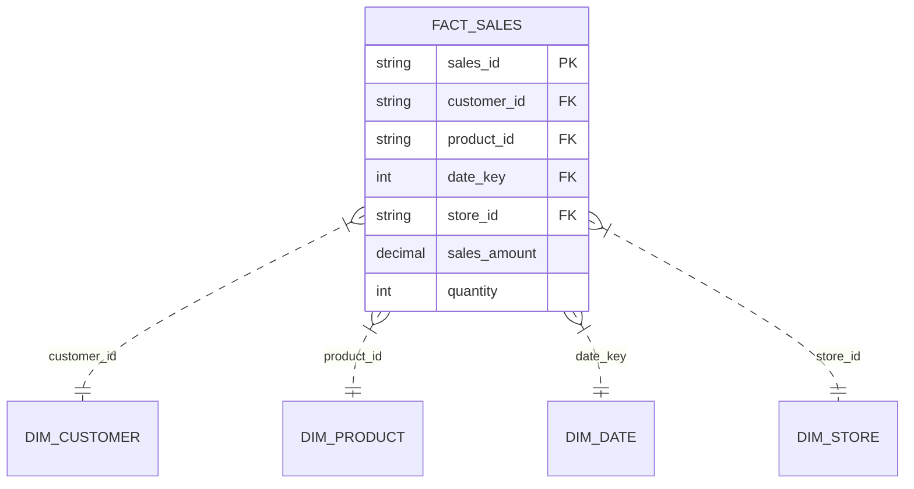

# Databricks Lakehouse & Azure Data Engineering: Master Preparation Guide

> **Comprehensive Interview Preparation Guide & Daily Study Textbook for Dedeepya Majety**  
> **Target Roles:** Azure Data Engineer, Databricks Platform Engineer, PySpark ETL Architect, Lakehouse Specialist  
> **Format:** Self-contained, production-grade reference manual formatted for daily reading and PDF export.  
> **Core Focus:** First principles, architectural trade-offs, internal mechanics, and real-world production incident response.

---

## Table of Contents

1. [Executive Study Plan & How to Read Daily](#1-executive-study-plan--how-to-read-daily)
2. [Module 1: The Lakehouse Paradigm & Core Definitions](#2-module-1-the-lakehouse-paradigm--core-definitions)
3. [Module 2: Delta Lake Internals Under the Hood](#3-module-2-delta-lake-internals-under-the-hood)
4. [Module 3: Ingestion Engineering with Databricks Auto Loader](#4-module-3-ingestion-engineering-with-databricks-auto-loader)
5. [Module 4: Distributed Computing & PySpark Optimization Mastery](#5-module-4-distributed-computing--pyspark-optimization-mastery)
6. [Module 5: Enterprise Governance with Unity Catalog & MDM](#6-module-5-enterprise-governance-with-unity-catalog--mdm)
7. [Module 6: Workflow Orchestration & DataOps (Airflow vs ADF vs DABs)](#7-module-6-workflow-orchestration--dataops-airflow-vs-adf-vs-dabs)
8. [Module 7: Analytics, Serving & Power BI Integration](#8-module-7-analytics-serving--power-bi-integration)
9. [Module 8: Top 30 Rapid-Fire Technical Interview Questions & Model Answers](#9-module-8-top-30-rapid-fire-technical-interview-questions--model-answers)
10. [Module 9: High-Agency Inversion Questions for Data Platform Leads](#10-module-9-high-agency-inversion-questions-for-data-platform-leads)

---

## 1. Executive Study Plan & How to Read Daily

### The 20-Minute Daily Retention Ritual
- **Day 1 (Core Concepts):** Read Module 1 & Module 2 (Lakehouse paradigm, Delta log internals, ACID mechanics).
- **Day 2 (Ingestion & Pipelines):** Read Module 3 & Module 4 (Auto Loader, Structured Streaming, PySpark execution, and skew salting).
- **Day 3 (Governance & DataOps):** Read Module 5, Module 6 & Module 7 (Unity Catalog, Airflow vs ADF, Power BI Direct Lake).
- **Day 4 (Interview Simulations):** Drill Module 8 (Rapid-Fire Questions) out loud without looking at the model answers.

---

## 2. Module 1: The Lakehouse Paradigm & Core Definitions

### What is a Data Lakehouse?
A **Data Lakehouse** is an architectural paradigm that combines the best features of **Data Lakes** (cheap object storage, support for unstructured/semi-structured data, open file formats) with the best features of **Data Warehouses** (ACID transactions, schema enforcement, data governance, indexing, and high-performance SQL querying).

```
┌────────────────────────────────────────────────────────────────────────┐
│                        DATA LAKEHOUSE EVOLUTION                        │
├────────────────────────────────────────────────────────────────────────┤
│ 1. Traditional Data Warehouse:                                         │
│    Fast SQL, ACID, high governance BUT expensive, proprietary, closed  │
│    storage, poor handling of unstructured video/audio/unparsed JSON.   │
├────────────────────────────────────────────────────────────────────────┤
│ 2. First-Generation Data Lake (Hadoop / Cloud Blob / Raw Parquet):     │
│    Cheap, massive scale BUT lack of ACID transactions, no updates,     │
│    small file swamps, corrupted partial writes, zero schema safety.    │
├────────────────────────────────────────────────────────────────────────┤
│ 3. The Modern Lakehouse (Delta Lake on ADLS Gen2 / S3):                │
│    Open Parquet files + ACID transaction log (_delta_log). Fast BI,    │
│    streaming ingest, machine learning, and centralized governance.     │
└────────────────────────────────────────────────────────────────────────┘
```

---

### What is Delta Lake?
**Delta Lake** is an open-source storage framework that brings reliability and performance to data lakes. It consists of two essential components sitting on top of cloud object storage (ADLS Gen2, AWS S3, or GCS):
1. **Parquet Data Files:** Columnar, compressed payload files holding the actual data.
2. **The `_delta_log/` Transaction Log:** An append-only sequence of JSON and checkpoint Parquet files recording every commit, schema change, and file addition/deletion.

---

### What is the Medallion Architecture?
The **Medallion Architecture** (also known as the multi-hop data architecture) is a data design pattern that logically organizes data into progressive refinement tiers: **Bronze (Raw)**, **Silver (Cleaned & Conformed)**, and **Gold (Curated Business Marts)**.

```mermaid
flowchart LR
    subgraph Staging ["Transient Staging Zone"]
        RawDrop[Raw File Drop / SFTP]
    end

    subgraph Bronze ["Bronze Tier: Raw Ingestion"]
        B[Append-Only Delta Table<br/>Exact source fidelity + metadata]
    end

    subgraph Silver ["Silver Tier: Cleaned & Conformed"]
        S[Deduplicated & Enriched<br/>Schema enforced + Quality checked]
    end

    subgraph Gold ["Gold Tier: Curated Business Marts"]
        G[Star Schema Data Marts<br/>Aggregated KPIs for BI & SQL]
    end

    RawDrop -->|Auto Loader Ingestion| B
    B -->|PySpark Clean & Deduplicate| S
    S -->|Business Aggregation & Star Joins| G

    classDef stage fill:#F1F5F9,stroke:#64748B,stroke-width:2px,color:#1E293B;
    classDef bronze fill:#FEF3C7,stroke:#D97706,stroke-width:2px,color:#92400E;
    classDef silver fill:#F1F5F9,stroke:#64748B,stroke-width:2px,color:#334155;
    classDef gold fill:#FEF9C3,stroke:#CA8A04,stroke-width:2px,color:#854D0E;

    class RawDrop stage;
    class B bronze;
    class S silver;
    class G gold;
```



#### The Tier Separation Rule: "Does it Require Domain Knowledge?"
When interviewers ask where a transformation belongs, apply the **Domain Knowledge Rule**:
- **Silver Tier (Technical Cleaning):** Transformations that require **zero business context**: casting strings to timestamps, dropping null primary keys, deduplicating records by `(id, updated_at)`, standardizing address abbreviations, and masking sensitive PII.
- **Gold Tier (Business Context):** Transformations that require **business domain knowledge**: calculating churn rate, joining orders with marketing campaign attribution, applying financial revenue recognition rules, and building dimensional star schemas.
- **The "Convenience Trap":** Avoid putting business aggregations directly into Silver. If business definitions change, you are forced to reprocess the entire Silver tier instead of modifying only the lightweight Gold view.

---

## 3. Module 2: Delta Lake Internals Under the Hood

### How Delta Lake Works: The `_delta_log/` Anatomy
Every Delta table is a directory containing data files and a hidden `_delta_log/` subdirectory.

```
/mnt/adls/lakehouse/silver_orders/
├── _delta_log/
│   ├── 00000000000000000000.json     (Commit 0: Initial table creation)
│   ├── 00000000000000000001.json     (Commit 1: Append 50,000 rows)
│   ├── ...
│   ├── 00000000000000000010.json     (Commit 10: Delta merge / updates)
│   └── 00000000000000000010.checkpoint.parquet (Consolidated state up to commit 10)
├── part-00000-xxxx.snappy.parquet     (Active data file)
├── part-00001-yyyy.snappy.parquet     (Active data file)
└── part-00002-zzzz.snappy.parquet     (Tombstoned file - deleted in Commit 10)
```

#### Step-by-Step Commit Protocol
1. **JSON Commit Log:** Every write transaction creates a new zero-padded JSON file (e.g. `00000000000000000001.json`). The JSON file specifies:
   - `add`: Metadata of new Parquet files added (file path, row count, min/max statistics per column).
   - `remove`: Metadata of Parquet files deleted or tombstoned.
   - `commitInfo`: User ID, timestamp, operation type (`WRITE`, `MERGE`, `OPTIMIZE`).
2. **Checkpoint Parquet Files:** By default, every **10 commits**, Delta automatically compiles all preceding JSON commits into a single `checkpoint.parquet` file. When a reader queries the table, it reads the latest checkpoint plus subsequent JSON files instead of parsing hundreds of historical JSON logs, keeping query planning instantaneous.

---

### ACID Transactions via Optimistic Concurrency Control (OCC)
Delta Lake provides full ACID compliance using **Optimistic Concurrency Control (OCC)**:
1. **Read:** Reader reads the latest validated version of the table.
2. **Execute:** Writer performs transformations and writes new Parquet data files to storage.
3. **Validate:** Writer attempts to commit by writing the next sequential JSON log file (`N+1.json`).
4. **Conflict Check:** If another transaction committed `N+1.json` first, Delta checks if the conflicting commit touched the same files or partitions.
   - *No overlapping files:* Delta automatically retries the commit as `N+2.json` without failing.
   - *Overlapping files:* Delta throws a `ConcurrentModificationException` to preserve serializable consistency.

---

### Time Travel: How It Works
Because Delta Lake never mutates files in place (it marks old files as `remove` in the JSON log and writes new Parquet files), historical snapshots remain on disk until vacuumed.

```sql
-- Query snapshot at a specific version
SELECT * FROM enterprise_lakehouse.silver.orders VERSION AS OF 14;

-- Query snapshot as of yesterday afternoon
SELECT * FROM enterprise_lakehouse.silver.orders 
TIMESTAMP AS OF '2026-10-01 14:30:00';

-- Restore table back to version 12 after a corrupted batch run
RESTORE TABLE enterprise_lakehouse.silver.orders TO VERSION AS OF 12;
```

---

### Compaction & Clustering: `OPTIMIZE`, `Z-ORDER`, and Liquid Clustering

#### 1. The Small File Problem
Frequent micro-batch streaming writes generate thousands of tiny 1MB to 5MB Parquet files. When a query scans the table, filesystem listing latency dominates execution time.

#### 2. Bin-Packing with `OPTIMIZE`
Running `OPTIMIZE table_name` compacts small files into optimal **1GB Parquet files**, eliminating read amplification.

#### 3. Data Skipping with `Z-ORDER BY`
`Z-ORDER BY (colA, colB)` maps multi-dimensional data into a one-dimensional space along a Peano space-filling curve. When queries filter on `colA` or `colB`, Delta Lake reads the column min/max statistics in the `_delta_log` and skips 90%+ of irrelevant Parquet files without reading them.

```sql
OPTIMIZE enterprise_lakehouse.gold.fact_sales
ZORDER BY (customer_id, transaction_date);
```

#### 4. Modern Liquid Clustering (`CLUSTER BY`)
In newer Databricks runtimes, **Liquid Clustering** replaces traditional Hive partitioning and Z-Ordering. It allows dynamic clustering on any column without table re-writes, adjusts automatically to data growth, and prevents partition over-segmentation.

```sql
CREATE TABLE enterprise_lakehouse.silver.events (
    event_id STRING,
    user_id STRING,
    event_time TIMESTAMP,
    payload STRING
)
USING DELTA
CLUSTER BY (user_id, event_time);
```

---

### Table Cleanup with `VACUUM`
While tombstoned Parquet files are ignored by active readers, they still occupy cloud storage. 
`VACUUM` permanently deletes files that are no longer referenced in the latest commit log and are older than the retention threshold:

```sql
-- Deletes files unreferenced and older than 168 hours (7 days default)
VACUUM enterprise_lakehouse.silver.orders;

-- Retain 30 days for compliance before purging
VACUUM enterprise_lakehouse.silver.orders RETAIN 720 HOURS;
```
*Safety Note:* Setting retention below 168 hours requires disabling the safety check (`SET spark.databricks.delta.vacuum.parallelDelete.enabled = true`), which should never be done in production because active concurrent readers could crash if their open file is deleted mid-query.

---

## 4. Module 3: Ingestion Engineering with Databricks Auto Loader

### What is Databricks Auto Loader?
**Auto Loader** (`format("cloudFiles")`) is an optimized cloud ingestion engine in Databricks designed to process millions of incoming files incrementally, efficiently, and cost-effectively from cloud object storage (ADLS Gen2, AWS S3, GCS) into Delta Lake without maintaining manual file tracking ledgers.

---

### Auto Loader Ingestion Modes: Directory Listing vs. File Notification

| Dimension | Directory Listing Mode | File Notification Mode |
| :--- | :--- | :--- |
| **How it Discovers Files** | Scans cloud directory recursively via storage listing APIs. | Subscribes to storage event notifications via Azure Event Grid + Azure Storage Queue (or AWS SNS/SQS). |
| **Recommended Scale** | Tables receiving < 1 million files total, or infrequent batch file drops. | Tables receiving > 1 million files, continuous streaming, or high file velocity. |
| **Cloud Infrastructure Cost** | High storage API read cost as folder size grows ($0.05 per 10k list calls). | Low, predictable message queue cost; zero directory listing calls. |
| **Setup Complexity** | Zero cloud configuration; just point to the directory path. | Requires cloud IAM permissions to provision Event Grid and Queue services. |
| **Configuration** | Default mode. | `.option("cloudFiles.useNotifications", "true")` |

---

### Schema Inference & Automated Schema Evolution
Auto Loader can detect schema changes in incoming files and evolve the destination Delta table automatically:

```python
bronze_stream = (
    spark.readStream.format("cloudFiles")
    .option("cloudFiles.format", "json")
    .option("cloudFiles.schemaLocation", "/mnt/adls/checkpoints/schema_orders")
    .option("cloudFiles.inferColumnTypes", "true")
    .option("cloudFiles.schemaEvolutionMode", "addNewColumns")
    .load("/mnt/adls/raw_landing/orders/")
    .writeStream
    .format("delta")
    .option("checkpointLocation", "/mnt/adls/checkpoints/orders_bronze_stream")
    .option("mergeSchema", "true")
    .outputMode("append")
    .table("enterprise_lakehouse.bronze.orders")
)
```

#### The 4 Schema Evolution Modes:
1. `addNewColumns` (Default): Appends new columns automatically. Missing columns are filled with `NULL`.
2. `rescueData`: Writes malformed or untyped data into a designated `_rescued_data` JSON column rather than failing the stream.
3. `failOnNewColumns`: Fails the pipeline if an unexpected column appears, requiring data engineer approval.
4. `none`: Ignores new columns; parses only the pre-defined schema.

---

## 5. Module 4: Distributed Computing & PySpark Optimization Mastery

### The Spark Execution Hierarchy
```
Driver Program ───► SparkSession ───► DAG Scheduler ───► Task Scheduler
                                                              │
                                      ┌───────────────────────┴───────────────────────┐
                                      ▼                                               ▼
                              Executor 1 (Worker)                             Executor 2 (Worker)
                              ├── Task 1 (Core 1)                             ├── Task 3 (Core 1)
                              └── Task 2 (Core 2)                             └── Task 4 (Core 2)
```
- **Application:** The entire program submitted via notebook or job jar.
- **Job:** Created whenever an **action** is called (`.count()`, `.collect()`, `.write()`, `.save()`).
- **Stage:** A unit of execution within a job. Stages are split by **wide dependencies** (operations that require a network shuffle like `.groupBy()`, `.join()`, `.distinct()`).
- **Task:** The smallest unit of execution, running on a single partition of data within a single CPU core on an executor node.

---

### Narrow vs. Wide Transformations
- **Narrow Transformations (No Network Shuffle):** Each partition of the parent DataFrame is used by at most one partition of the child DataFrame (e.g., `filter()`, `select()`, `map()`, `withColumn()`). Tasks execute entirely in local RAM.
- **Wide Transformations (Requires Network Shuffle):** Multiple child partitions depend on data distributed across multiple parent partitions (e.g., `groupBy()`, `join()`, `distinct()`, `repartition()`). Data must be serialized, sent across the network, and sorted, making wide transformations the primary source of job latency and OOM risk.

---

### PySpark Join Strategies Under the Hood

| Join Strategy | When Spark Uses It | How It Works | Network Overhead |
| :--- | :--- | :--- | :--- |
| **Broadcast Hash Join (BHJ)** | One table is small (< `spark.sql.autoBroadcastJoinThreshold`, default 10MB, safe up to ~50MB). | The driver downloads the small table, builds an in-memory hash table, and broadcasts it to all executor workers. | **Zero shuffle** of the large table. Fastest join possible. |
| **Shuffle Hash Join (SHJ)** | Both tables are large, but one is smaller than the other; sorting is disabled or expensive. | Both tables are hashed on the join key and shuffled so matching keys land on the same node. A hash table is built in executor RAM. | High network shuffle. Fails if hash table exceeds executor memory. |
| **Sort Merge Join (SMJ)** | Both tables are large (default join strategy for big data). | Both tables are shuffled by join key, sorted on disk/RAM by the key, and then merged by a linear scan. | High network shuffle + disk sort overhead, but resilient against OOM. |

---

### The Data Skew Problem & How to Fix It

#### 1. What is Data Skew?
Data skew occurs when data is distributed unevenly across partitions due to high-cardinality imbalances on the partition key. In the Spark UI, 199 tasks finish in 5 seconds, while 1 single task runs for 45 minutes and eventually crashes with `ExecutorLostFailure (exit code 137: OOM)`.

#### 2. The Salting Technique
Salting artificially distributes skewed join keys across multiple buckets by concatenating a random integer from `1` to `N`:

```python
from pyspark.sql import functions as F

# Step 1: Add a salt key to the large skewed table (1 to 5)
large_df_salted = large_df.withColumn("salt", F.concat(F.col("skewed_key"), F.lit("_"), F.floor(F.rand() * 5)))

# Step 2: Replicate the lookup dimension table 5 times with matching salt keys
salt_numbers = F.array([F.lit(i) for i in range(5)])
dim_df_exploded = dim_df.withColumn("salt_num", F.explode(salt_numbers)) \
                        .withColumn("salt", F.concat(F.col("skewed_key"), F.lit("_"), F.col("salt_num")))

# Step 3: Join on the salted key (distributes the single hot key across 5 executors)
joined_df = large_df_salted.join(dim_df_exploded, on="salt", how="inner").drop("salt", "salt_num")
```

---

### Adaptive Query Execution (AQE)
In Databricks, **AQE** dynamically re-optimizes query physical plans at runtime using stage runtime statistics:
1. **Dynamic Partition Coalescing:** Automatically merges small shuffle partitions (e.g., combining 200 default partitions into 12) to avoid small task overhead.
2. **Dynamic Skew Join Optimization:** Detects skewed partitions at runtime and splits them into smaller sub-partitions automatically without manual code edits (`spark.sql.adaptive.skewJoin.enabled = true`).
3. **Dynamic Join Strategy Switching:** If a large table is filtered down during execution to under 10MB, AQE switches a planned Sort-Merge Join into a Broadcast Hash Join on the fly.

---

## 6. Module 5: Enterprise Governance with Unity Catalog & MDM

### Databricks Unity Catalog Architecture
**Unity Catalog** provides centralized access control, auditing, data lineage, and metadata discovery across all Databricks workspaces.

```
METASTORE (Tenant / Region Root)
└── CATALOG (e.g. enterprise_prod)
    └── SCHEMA / DATABASE (e.g. silver)
        ├── TABLE (e.g. orders)
        ├── VIEW (e.g. v_daily_revenue)
        ├── VOLUME (Object storage files / unstructured data)
        └── MODEL (MLflow registered models)
```

#### Centralized Access Control (ANSI SQL RBAC)
```sql
-- Grant read-only access to analytics group on Silver tier
GRANT USAGE ON CATALOG enterprise_prod TO `data_analysts`;
GRANT USAGE ON SCHEMA enterprise_prod.silver TO `data_analysts`;
GRANT SELECT ON TABLE enterprise_prod.silver.orders TO `data_analysts`;

-- Dynamic Column-Level Masking for PII protection
CREATE OR REPLACE MASK mask_phone_number AS
(val STRING) -> CASE 
    WHEN is_account_group_member('compliance_officers') THEN val
    ELSE CONCAT('XXX-XXX-', RIGHT(val, 4))
END;

ALTER TABLE enterprise_prod.silver.customers 
ALTER COLUMN phone_number SET MASK mask_phone_number;
```

---

### Informatica Master Data Management (MDM) Golden Records
In enterprise data platforms, multi-channel customer records must be resolved into a single source of truth:
1. **Match-and-Merge Rules:** Configure exact match rules (Tax ID, Government ID) and fuzzy match rules (Jaro-Winkler distance on Name, Metaphone on Address).
2. **Trust Scoring & Decay:** Assign trust curves per source system. A recent CRM phone update receives a 95% trust score, while an unverified 3-year-old billing address decays to 40%.
3. **Survivorship Logic:** When merging two customer profiles, the MDM engine selects the attribute with the highest active trust score to generate the **Golden Master Record**.

---

## 7. Module 6: Workflow Orchestration & DataOps (Airflow vs ADF vs DABs)

### Tool Comparison Matrix

| Capability | Azure Data Factory (ADF) | Apache Airflow | Databricks Workflows / DABs |
| :--- | :--- | :--- | :--- |
| **Primary Strength** | Serverless data movement, cross-cloud/on-prem hybrid file transfer, low-code. | Complex conditional logic, dynamic Python DAG generation, cross-platform scheduling. | Deep native Databricks integration, serverless compute management, job clusters. |
| **Pipeline Definition** | JSON templates via Azure Portal / ARM templates. | Pure Python code (`DAG`, `PythonOperator`, `BashOperator`). | YAML specification via **Databricks Asset Bundles (DABs)** committed in git. |
| **Failure Alerting** | Azure Monitor, Action Groups, Logic Apps. | Native Slack/Email callback hooks (`on_failure_callback`). | Built-in email, PagerDuty, Slack webhooks per task. |
| **Testing in CI/CD** | ARM template parameter validation. | Unit testing DAGs with **Pytest** (`dag.test()`, cycle detection). | `databricks bundle validate` in GitHub Actions. |

---

### Designing Idempotent Pipelines
An **idempotent pipeline** produces the exact same outcome regardless of whether it is executed once or retried five times after an intermediate network failure.

#### How Dedeepya Enforces Idempotency in Delta Lake:
1. **Never use plain `.write.mode("append")` without deduplication:** An append mode retry duplicates rows if the previous write committed before logging a success status.
2. **Use Delta Lake `MERGE INTO` with Unique Business Keys:** The merge statement checks existing records on `(order_id)` and updates matching rows while inserting new ones, guaranteeing identical state upon rerun.
3. **Partition Overwrites for Batch Daily Jobs:**
   ```python
   (
       df.write.format("delta")
       .mode("overwrite")
       .option("replaceWhere", "order_date = '2026-10-01'")
       .saveAsTable("enterprise_lakehouse.silver.orders")
   )
   ```
   If the job fails halfway, Delta Lake's atomic transaction log discards partial files; upon retry, the entire daily partition is cleanly replaced without duplicate rows.

---

## 8. Module 7: Analytics, Serving & Power BI Integration

### Power BI Storage Modes: Direct Lake vs. DirectQuery vs. Import

| Feature | Import Mode | DirectQuery Mode | Direct Lake Mode (Modern Standard) |
| :--- | :--- | :--- | :--- |
| **Mechanism** | Copies data into Power BI VertiPaq memory cache. | Translates user visual clicks into live SQL queries against database. | Directly reads **Delta Parquet files from ADLS Gen2 / OneLake** into VertiPaq memory without query translation or data copying. |
| **Data Freshness** | Stale; requires scheduled data refreshes. | Real-time live data. | **Near real-time:** instantly reflects Delta Lake table commits. |
| **Query Performance** | Blazing fast (in-memory). | Slow; constrained by database query processing time. | **Blazing fast:** matches Import mode speed without duplicate storage. |
| **Dataset Size Limits** | Bounded by Power BI Premium capacity memory (e.g. 25GB to 400GB). | Unlimited (data stays in database). | Massive lakehouse scale (billions of rows). |

---

### Star Schema Modeling & DAX Calculation Discipline



#### Core DAX Optimization Best Practices:
1. **Avoid `FILTER(all_table, condition)`:** It scans the entire table; use `CALCULATE(SUM(table[val]), table[col] = "condition")` to leverage VertiPaq bitmap indexes.
2. **Semi-Additive Measures:** Use `LASTDATE()` or `CLOSINGBALANCEMONTH()` for balance-sheet calculations where figures cannot be summed across dates.
3. **Divide by Zero Protection:** Always use `DIVIDE(numerator, denominator, 0)` rather than `/` operator to eliminate divide-by-zero calculation errors.

---

## 9. Module 8: Top 30 Rapid-Fire Technical Interview Questions & Model Answers

### Q1: What is the primary difference between Delta Lake and Apache Parquet?
* **Answer:** Apache Parquet is an immutable columnar storage file format. Delta Lake is an open storage layer built on top of Parquet that introduces an ACID transaction log (`_delta_log`), enabling ACID transactions, time travel, schema enforcement, and row-level upserts/deletes.

### Q2: What is the difference between Schema Enforcement and Schema Evolution?
* **Answer:** Schema Enforcement prevents bad data from corrupting tables by failing any write that introduces unexpected columns or mismatched data types. Schema Evolution allows users to easily change a table's current schema to accommodate data that is changing over time by setting `.option("mergeSchema", "true")`.

### Q3: How does Auto Loader track which files have been processed?
* **Answer:** Auto Loader tracks processed files using an internal RocksDB state store located in the checkpoint directory (`checkpointLocation`). It stores file paths and timestamps, ensuring exactly-once processing even if millions of files are added across months.

### Q4: Why is `_delta_log` structured with both JSON and Parquet checkpoint files?
* **Answer:** JSON files record individual transaction commits in order. To prevent query planning from reading thousands of individual JSON files as table history grows, Delta Lake automatically compiles the cumulative state every 10 commits into a consolidated Parquet checkpoint file for fast metadata reading.

### Q5: What is the difference between a Managed Table and an External Table in Databricks?
* **Answer:** In a **Managed Table**, Databricks manages both the table metadata and the physical data files. Dropping the table drops both the metadata and the underlying storage files. In an **External Table**, Databricks only manages the metadata; the data resides in a custom storage location (ADLS Gen2 URI). Dropping an external table drops only the metadata in the metastore; the underlying Parquet files remain intact on object storage.

### Q6: What does the `VACUUM` command do, and why is there a 7-day retention safety check?
* **Answer:** `VACUUM` permanently deletes data files that are no longer referenced by the latest Delta transaction log and are older than a specified retention period. The default 7-day (168-hour) safety check prevents deleting files that may still be in use by active long-running queries or historical reading sessions.

### Q7: What is the purpose of `Z-ORDER BY` in Delta Lake?
* **Answer:** Z-Ordering is a technique to colocate related information in the same set of files along a space-filling curve. It allows Delta Lake's data skipping algorithm to dramatically reduce the amount of data scanned when queries filter on high-cardinality columns.

### Q8: What is Liquid Clustering, and how does it improve upon Z-Ordering?
* **Answer:** Liquid Clustering (`CLUSTER BY`) replaces static partitioning and Z-Ordering. It enables flexible clustering on multiple columns without data rewriting, dynamically adjusts cluster layouts as data patterns evolve, and prevents the "over-partitioning" problem common in legacy Hive partition schemes.

### Q9: What happens when an Out-Of-Memory (OOM) error occurs on a Spark Executor?
* **Answer:** Executor OOM usually happens when a single task processes too much data due to partition data skew, or when a broadcast join exceeds executor memory limits. The JVM crashes with Java heap space exhaustion, and the Spark Driver attempts to re-launch the task on another executor before failing the job after four retries.

### Q10: How do you fix data skew in a PySpark join?
* **Answer:** Enable Adaptive Query Execution (`spark.sql.adaptive.skewJoin.enabled = true`), use Broadcast Joins for small dimension tables, or implement **key salting** by appending a random integer to the join key to break a massive skewed partition into multiple evenly distributed buckets.

### Q11: What is the difference between `repartition()` and `coalesce()` in PySpark?
* **Answer:** `repartition(N)` does a full network shuffle to redistribute data evenly across `N` partitions (can increase or decrease partition count). `coalesce(N)` decreases the number of partitions by merging adjacent partitions locally without triggering a full network shuffle, making it significantly faster for reducing partitions before writing to storage.

### Q12: Why should you avoid calling `.collect()` or `.toPandas()` in production PySpark scripts?
* **Answer:** `.collect()` pulls all distributed data from worker executors across the cluster into the single Driver node memory. On large enterprise datasets, this immediately exhausts Driver RAM and crashes the entire Spark application with an Out-Of-Memory failure.

### Q13: What is a Watermark in PySpark Structured Streaming?
* **Answer:** A watermark defines the threshold for how long Spark will wait for late-arriving data in event-time stateful operations. Any record whose event time is older than `current_max_event_time - watermark_delay` is dropped from state memory, bounding memory growth and preventing unbounded state leak.

### Q14: How does Databricks Unity Catalog differ from legacy Hive Metastore?
* **Answer:** Legacy Hive Metastore operates at the single-workspace level and lacks centralized security, auditing, and fine-grained column masking. Unity Catalog provides a centralized, cross-workspace metastore using a three-level namespace (`catalog.schema.table`), supporting ANSI SQL access control, dynamic data masking, row filters, and automated end-to-end data lineage.

### Q15: How do you achieve 100% data parity when migrating legacy Informatica ETL to Databricks?
* **Answer:** Run parallel shadow pipelines where both Informatica and Databricks process the same source feeds. Run automated reconciliation Pytest scripts comparing row counts, schema signatures, primary key presence, and hashing column contents (e.g. `MD5` or `SHA-256` checksums over concatenated non-key attributes) to guarantee identical data parity before decommissioning the legacy system.

### Q16: What is the difference between Azure Data Factory (ADF) and Apache Airflow?
* **Answer:** ADF is a managed serverless cloud service ideal for low-maintenance, cross-cloud or on-prem hybrid data movement and simple scheduling. Airflow is a code-first Python orchestrator that allows complex dynamic DAG generation, rich dependency branching, custom operator extensions, and deep programmatic CI/CD integration.

### Q17: What is an idempotent data pipeline?
* **Answer:** A pipeline where executing the process multiple times with the same input produces the exact same result without duplicate rows or corrupted state. In Delta Lake, idempotency is achieved using `MERGE INTO` operations on primary keys or atomic partition overwrites via `replaceWhere`.

### Q18: What is Power BI Direct Lake mode?
* **Answer:** Direct Lake is a capability in Microsoft Fabric / Power BI that directly reads Delta Parquet tables from OneLake / ADLS Gen2 into Power BI's in-memory VertiPaq engine. It provides the blazing speed of Import mode without copying data or waiting for scheduled data refreshes, and avoids the query latency of DirectQuery.

### Q19: What is the difference between a Star Schema and a Snowflake Schema?
* **Answer:** A **Star Schema** connects a central Fact table directly to denormalized Dimension tables with single-hop relationships, maximizing query speed and simplicity in columnar engines. A **Snowflake Schema** normalizes dimension tables into sub-dimensions (multi-hop relationships), reducing storage redundancy but increasing join complexity and query latency.

### Q20: What are Semi-Additive Measures in DAX?
* **Answer:** Measures that can be summed across some dimensions (e.g. products, stores) but cannot be summed across time (e.g. inventory balances, bank account balances). In DAX, they are calculated using `CALCULATE()` paired with `LASTDATE()` or `CLOSINGBALANCEMONTH()`.

### Q21: What is the function of Databricks Asset Bundles (DABs)?
* **Answer:** DABs are an Infrastructure-as-Code (IaC) tool for Databricks that allows data engineering teams to define, version-control, test, and deploy entire data platforms (notebooks, pipelines, jobs, cluster configs) via declarative YAML files integrated into standard GitHub CI/CD workflows.

### Q22: What is the difference between an Interactive Cluster and a Job Cluster in Databricks?
* **Answer:** An **Interactive Cluster** is a multi-user cluster used for ad-hoc analysis and notebook development; it stays running until auto-terminated, incurring higher costs. A **Job Cluster** is spun up automatically by the Databricks scheduler specifically to run a single automated pipeline task and terminates immediately upon completion, billed at a significantly lower DBU rate (Data Compute unit).

### Q23: How do you handle malformed records in Databricks Auto Loader?
* **Answer:** By setting `.option("cloudFiles.schemaEvolutionMode", "rescueData")`, Auto Loader automatically routes any malformed records, type mismatches, or unexpected columns into a dedicated `_rescued_data` column in the destination Delta table, allowing the pipeline to continue running without dropping bad data or failing the batch.

### Q24: What is the difference between `spark.read` and `spark.readStream`?
* **Answer:** `spark.read` performs a bounded batch read of existing data files at a specific point in time. `spark.readStream` initiates an unbounded streaming read, continually monitoring the source for new data arrivals and processing micro-batches incrementally using Structured Streaming checkpoints.

### Q25: What is the purpose of checkpointing in PySpark Structured Streaming?
* **Answer:** Checkpointing stores the current offset progress, state store parameters, and commit metadata into a durable cloud storage directory. If a stream fails or is restarted, it reads the checkpoint to resume processing from the exact offset where it stopped, providing strictly **exactly-once** processing guarantees.

### Q26: What is Dynamic Data Masking in Unity Catalog?
* **Answer:** A governance feature where SQL user-defined functions (UDFs) are applied to sensitive columns to redact or mask data at query time based on user group membership (e.g., masking credit card numbers or phone numbers for general analysts while showing raw data to compliance officers) without altering physical storage.

### Q27: How does broadcast join threshold tuning impact PySpark performance?
* **Answer:** `spark.sql.autoBroadcastJoinThreshold` sets the maximum table size (default 10MB) that Spark will broadcast to all worker nodes to avoid a network shuffle. Increasing this threshold (e.g. to 50MB) accelerates joins between large fact tables and medium dimension tables, but setting it too high risks Driver or Executor Out-Of-Memory errors.

### Q28: What is the role of Informatica MDM Trust Scores?
* **Answer:** Trust scores quantify the reliability and accuracy of an attribute from a specific source system on a scale of 0 to 100%. Trust decay rules allow recent CRM inputs to supersede older ERP records during the automated match-merge process, ensuring the golden master record contains the most accurate data.

### Q29: What is Query Folding in Power BI / Power Query?
* **Answer:** Query Folding is the ability of Power Query to translate data transformation steps (filtering rows, selecting columns, joining) into a single native SQL statement executed directly by the source database, eliminating the need to pull raw tables over the network into Power BI before filtering.

### Q30: How did your work at Cognizant deliver a 40% pipeline runtime reduction?
* **Answer:** By replacing monolithic daily batch Informatica PowerCenter jobs with incremental Auto Loader ingestion on ADLS Gen2, implementing PySpark window function deduplication in memory, eliminating redundant self-joins, leveraging Delta Lake ACID merges, and rightsizing Databricks compute clusters with auto-scaling and spot instances.

---

## 10. Module 9: High-Agency Inversion Questions for Data Platform Leads

Ask these questions at the end of technical panel interviews to signal Staff-level platform maturity:

1. *"As your lakehouse architecture expands to support real-time reporting, how does your team manage the balance between continuous streaming ingestion with Auto Loader versus scheduled batch jobs to keep Databricks compute spend optimized?"*
2. *"What has been your team's experience implementing Databricks Unity Catalog across production workspaces: did you encounter friction migrating existing metastores, and how do you enforce table and column-level RBAC?"*
3. *"For lakehouse table maintenance, do you rely on automated Databricks Liquid Clustering and scheduled VACUUM routines, or do you run custom maintenance DAGs in Airflow to prevent small-file performance degradation?"*
4. *"How do you enforce data quality contracts between the Silver and Gold tiers: do you use Delta Lake CHECK constraints, Great Expectations, or custom automated PySpark test assertions in CI/CD?"*
5. *"What does your deployment pipeline look like for Databricks notebooks and pipelines: do you use Databricks Asset Bundles (DABs) with automated pull request reviews, or a custom Azure DevOps CI/CD pipeline?"*
