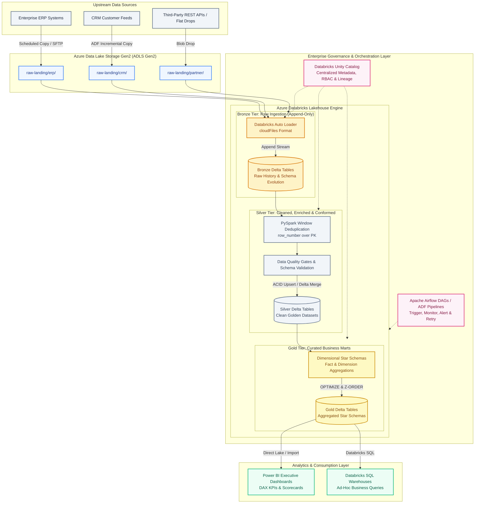

# Delta Lake Medallion Architecture: High-Level System Design Dossier

> **Primary Technical Interview Dossier for Dedeepya Majety**  
> **Target Scope:** Lead Data Engineer, Platform Architect, and Senior Lakehouse Engineering Screens  
> **Core Weapon:** Legacy Informatica to Azure Databricks Delta Lake Modernization (40% Runtime Cut, ~30% Cost Cut)  
> **Fact-Provenance:** Grounded in production engineering delivery at Cognizant Technology Solutions and official Databricks certification standards.

---

## 1. Executive Problem Statement & Modernization Business Case

### The Legacy Problem (On-Premises Informatica PowerCenter)
- **Monolithic Batch Windows:** Daily ETL pipelines struggled to complete within night-time batch windows, causing frequent SLA breaches (processing exceeding 8+ hours).
- **Rigid Schema Bottlenecks:** Incoming changes in upstream ERP and CRM feeds required manual mapping alterations, slowing data delivery to downstream business users.
- **Lack of ACID Guarantees:** Pipeline failures mid-batch resulted in partial writes and corrupted staging tables, requiring tedious manual cleanup and reprocessing.
- **High Licensing Costs:** Scaling on-premise Informatica server cores imposed steep software licensing and hardware upgrade expenses.

### The Modern Lakehouse Solution (Azure Databricks Delta Lake)
- Replaced monolithic batch loads with **continuous micro-batch ingestion using Databricks Auto Loader** (`cloudFiles`) from ADLS Gen2.
- Implemented an enterprise **Medallion Architecture (Bronze $\rightarrow$ Silver $\rightarrow$ Gold)** with automated schema evolution, data quality validation gates, and ACID transaction guarantees.
- Achieved a **40% reduction in average pipeline runtime**, **~30% infrastructure cost savings** via cluster rightsizing and auto-scaling, and verified **100% data parity** against historical benchmarks.

---

## 2. End-to-End System Architecture Diagram



---

## 3. Deep-Dive: The 3 Medallion Tiers & Production Code

### 1. Bronze Tier: Auto Loader Continuous Ingestion
- **Mechanism:** Leveraged Databricks Auto Loader (`cloudFiles`) with Azure Event Grid notification mode to automatically detect new files deposited into ADLS Gen2 raw containers.
- **Schema Evolution:** Set `cloudFiles.schemaLocation` to store inferred schemas durably, allowing new columns in upstream JSON/CSV files to append automatically without pipeline crashes.

```python
# autoloader_bronze_ingest.py
from pyspark.sql import functions as F

bronze_stream = (
    spark.readStream.format("cloudFiles")
    .option("cloudFiles.format", "json")
    .option("cloudFiles.schemaLocation", "/mnt/adls/checkpoints/schema_bronze_orders")
    .option("cloudFiles.inferColumnTypes", "true")
    .load("/mnt/adls/raw_landing/orders/")
    .withColumn("ingestion_timestamp", F.current_timestamp())
    .withColumn("source_filename", F.input_file_name())
    .writeStream.format("delta")
    .option("checkpointLocation", "/mnt/adls/checkpoints/bronze_orders")
    .outputMode("append")
    .table("enterprise_lakehouse.bronze.orders")
)
```

---

### 2. Silver Tier: PySpark Window Deduplication & ACID Delta Merge
- **Mechanism:** Cleaned and conformed raw records by casting datatypes, dropping null primary keys, and resolving duplicate events using PySpark window functions.
- **ACID Upsert:** Executed Delta Lake `merge` operations to update existing customer and transaction records while inserting newly arrived entities.

```python
# silver_medallion_merge.py
from delta.tables import DeltaTable
from pyspark.sql import Window
from pyspark.sql.functions import col, row_number

silver_target = DeltaTable.forName(spark, "enterprise_lakehouse.silver.orders")

# Deduplicate micro-batch by taking the latest updated record per order_id
window_spec = Window.partitionBy("order_id").orderBy(col("updated_at").desc())

deduped_updates = (
    spark.read.table("enterprise_lakehouse.bronze.orders")
    .filter("order_id IS NOT NULL")
    .withColumn("row_num", row_number().over(window_spec))
    .filter("row_num == 1")
    .drop("row_num")
)

# Delta Lake ACID Merge (Upsert)
(
    silver_target.alias("target")
    .merge(deduped_updates.alias("source"), "target.order_id = source.order_id")
    .whenMatchedUpdateAll()
    .whenNotMatchedInsertAll()
    .execute()
)
```

---

### 3. Gold Tier: Star Schema Marts & Compaction
- **Dimensional Modeling:** Modeled conformed fact tables (`FactOrders`) and dimension tables (`DimCustomer`, `DimProduct`, `DimDate`).
- **File Optimization:** Scheduled regular `OPTIMIZE` jobs with `Z-ORDER BY (customer_id, order_date)` clustering to colocate frequently filtered columns and eliminate small file performance degradation.

```sql
-- gold_performance_tuning.sql
OPTIMIZE enterprise_lakehouse.gold.fact_orders
ZORDER BY (customer_id, order_date);

VACUUM enterprise_lakehouse.gold.fact_orders RETAIN 168 HOURS;
```

---

## 4. Key Architectural Trade-offs & Production Troubleshooting

### 1. Small File Problem & Read Amplification
- **The Issue:** Streaming micro-batch writes in Bronze created thousands of small 500KB to 2MB Parquet files, creating metadata overhead and slow query response in downstream tables.
- **Dedeepya's Fix:** Enabled Delta Lake **Auto-Compaction** and **Optimized Writes** (`spark.databricks.delta.autoCompact.enabled = true`), automatically combining micro-files into optimized 128MB chunks upon commit.

### 2. Data Skew & Memory Spills in PySpark Joins
- **The Issue:** Joining transaction records against high-volume customer accounts caused partition skew, where single worker nodes spilled hundreds of megabytes to disk and triggered Out-Of-Memory (OOM) failures.
- **Dedeepya's Fix:** Implemented **Broadcast Joins** (`F.broadcast(dim_df)`) for dimension tables under 50MB, completely eliminating stage shuffle. For skewed large keys, applied **salting** (appending random integer keys from 1 to 10) to distribute data evenly across worker partitions before joining.

### 3. Unity Catalog Security & Lineage
- **Centralized RBAC:** Replaced workspace-local table ACLs with Unity Catalog three-level namespaces (`catalog.schema.table`).
- **Column-Level Masking:** Applied dynamic data masking on sensitive PII columns (customer phone numbers and credit card tokens) for non-admin analysts.

---

## 5. Technical Questions & Interview Answers

### Q1: "Why choose Delta Lake over Parquet files on Azure Blob Storage?"
* **Dedeepya's Answer:**  
  "Raw Parquet on Blob storage lacks ACID transaction guarantees. If a pipeline fails mid-write, partial files remain, corrupting downstream queries. Furthermore, standard Parquet does not support updates or deletes without completely rewriting entire partitions.
  
  Delta Lake introduces a JSON transaction log (`_delta_log`), which provides full ACID compliance, optimistic concurrency control, automated schema enforcement, time travel for rollbacks, and efficient upserts via `MERGE INTO`."

### Q2: "How do you decide between Azure Data Factory (ADF) and Apache Airflow?"
* **Dedeepya's Answer:**  
  "At Cognizant, we utilize a hybrid orchestration model. 
  
  We leverage **Azure Data Factory** for serverless, low-maintenance cross-system file movement (e.g. copying raw files from on-premises SFTP servers or external relational databases into ADLS Gen2 landing zones).
  
  For complex dependency graphs, conditional branch evaluations, and dynamic Databricks notebook execution, we use **Apache Airflow**. Airflow allows us to express workflow DAGs purely in Python, implement version-controlled CI/CD testing, and integrate programmatic alerting hooks via Slack or PagerDuty."

---

## 6. Architect-Level Inversion Questions for Data Platform Leads

Keep these 3 high-signal questions ready to ask Data Platform Architects or Engineering Managers:

1. *"As your lakehouse architecture scales, how does your team manage the balance between continuous streaming ingestion with Auto Loader versus scheduled batch jobs to keep Databricks compute costs optimized?"*
2. *"What has been your team's experience implementing Databricks Unity Catalog across legacy workspaces: did you encounter friction migrating existing external metastores, and how do you enforce table and column-level RBAC?"*
3. *"How does your data platform team ensure data quality and schema validation between Silver and Gold layers: do you rely on Delta Lake CHECK constraints, Great Expectations, or custom PySpark assertion suites in CI/CD?"*
